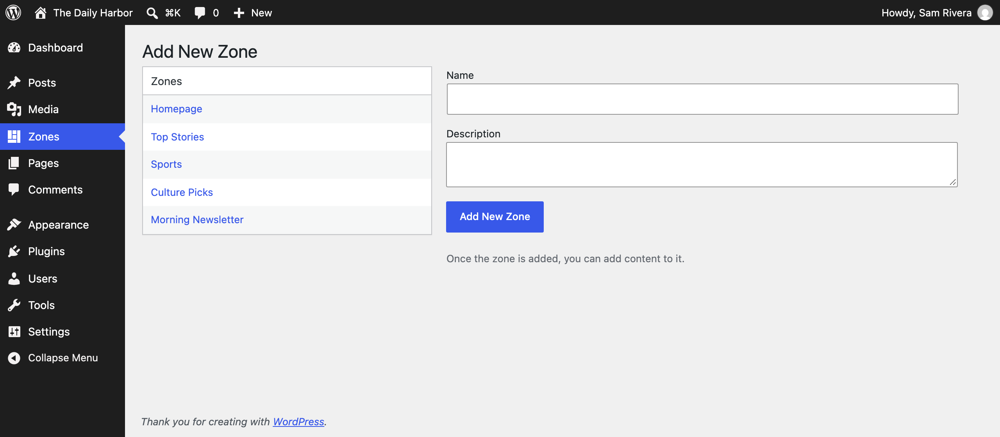
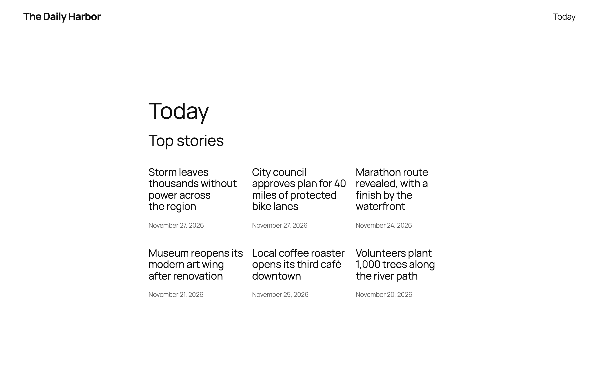

# Zone Manager (Zoninator)

Stable tag: 1.0.0  
Requires at least: 6.9  
Tested up to: 7.1  
Requires PHP: 8.2  
License: GPLv2 or later  
License URI: https://www.gnu.org/licenses/gpl-2.0.html  
Tags: zones, post order, post list, posts, order, zonination, content curation, curation, content management  
Contributors: batmoo, automattic, wpcomvip, pkevan, matthumphreys, potatomaster, jblz, nickdaugherty, betzster, garyj  

Create zones of selected posts in a set order, and display them on your site.

## Description

This plugin is designed to help you curate your content. It lets you assign and order stories within zones that you create, edit, and delete, and display those groupings of related stories on your site.

This plugin was originally built by [Mohammad Jangda](http://digitalize.ca) in conjunction with [William Davis](http://wpdavis.com/) and the [Bangor Daily News](http://www.bangordailynews.com/).

### Features

* Add, edit, and delete zones.
* Add and remove posts (or any post type that supports zones) to or from zones.
* Order posts in any given zone, by drag and drop or with the keyboard (Move up and Move down).
* Limit capabilities on who can add, edit, and delete zones vs add content to zones.
* Locking mechanism, so only one user can edit a zone at a time (to avoid conflicts).
* Idle control, so people can't keep the zone locked.

## Installation

1. Unzip contents and upload to the `/wp-content/plugins/` directory
2. Activate the plugin through the 'Plugins' menu in WordPress
3. Go to Zones in the admin menu to create and manage your zones, and easily search for and add existing posts.
4. Use the plugin's handy API functions to add zones to your theme that retrieve and display your content. Or, for those who are a bit code-averse, go to Appearance → Widgets and add Zone Posts widgets to display your zone posts in your sidebar or footer. The widget will pull the posts from the chosen zone. On a block theme, add the Zone Posts block to a page or template and pick the zone in its settings.

### Usage examples

You can work with a zone's posts either as a `WP_Query` object or as a plain array.

**WP_Query**

~~~php
$zone_query = zoninator_get_zone_query( 'homepage' );
if ( $zone_query->have_posts() ) :
	while ( $zone_query->have_posts() ) : $zone_query->the_post();
		echo '<li>' . esc_html( get_the_title() ) . '</li>';
	endwhile;
	wp_reset_postdata();
endif;
~~~

**Posts Array**

~~~php
$zone_posts = zoninator_get_posts_in_zone( 'homepage' );
foreach ( $zone_posts as $zone_post ) :
	echo '<li>' . esc_html( get_the_title( $zone_post->ID ) ) . '</li>';
endforeach;
~~~

For the full template-tag reference, see the [theme developer guide](https://github.com/Automattic/zoninator/blob/main/docs/theme-developers.md).

## Documentation

Audience-targeted documentation lives in the GitHub repository:

* [Theme developer guide](https://github.com/Automattic/zoninator/blob/main/docs/theme-developers.md) — using zones in your theme.
* [Hooks reference](https://github.com/Automattic/zoninator/blob/main/docs/hooks.md) — every filter and action the plugin exposes.
* [Changing zones from PHP](https://github.com/Automattic/zoninator/blob/main/docs/php-api.md) — creating zones and changing their posts in code.
* [REST API](https://github.com/Automattic/zoninator/blob/main/docs/rest-api.md) — endpoints under the `zoninator/v1` namespace, for headless integrations.
* [Abilities](https://github.com/Automattic/zoninator/blob/main/docs/abilities.md) — for AI agents and other tools.
* [Upgrading](https://github.com/Automattic/zoninator/blob/main/docs/upgrades.md) — what to check when you update, release by release.
* [Contributing](https://github.com/Automattic/zoninator/blob/main/CONTRIBUTING.md) — local setup, tests, and PR conventions.
* [Security](https://github.com/Automattic/zoninator/security/policy) — responsible disclosure.

## Frequently Asked Questions

### How do I disable the locking feature?

You can use a filter:

~~~php
add_filter( 'zoninator_zone_max_lock_period', 'zoninator_disable_locks' );
~~~

### How do I change the locking feature settings?

Filter the following and change according to your needs:

* How often, in seconds, the Zones screen renews a zone's lock, default `30`: `zoninator_zone_lock_period`
* How long, in seconds, an editor can leave a zone unchanged before the screen asks whether they're still working, default `600`: `zoninator_zone_max_lock_period`

### Can anonymous users read zones over the REST API?

Not by default. The `GET /wp-json/zoninator/v1/zones` endpoint needs a user who can edit posts or curate zones. To let anyone list the zones, use the `zoninator_rest_get_zones_permissions_check` filter:

~~~php
add_filter( 'zoninator_rest_get_zones_permissions_check', '__return_true' );
~~~

See the [REST API documentation](https://github.com/Automattic/zoninator/blob/main/docs/rest-api.md) for the full endpoint reference.

### Can I use Zoninator with custom post types?

Yes. Call `add_post_type_support( 'your_post_type', 'zoninator_zones' )`, or add `zoninator_zones` to the `supports` list when you register the post type.

## Upgrade Notice

### 1.0.0

Breaking release: needs WordPress 6.9 and PHP 8.2. Template tags are renamed from `z_` to `zoninator_` and `Zoninator()` is removed, so update your theme first or it will stop with a fatal error. Read the upgrade guide before updating.

### 0.12.0

Check the upgrade guide if your code reads Zoninator's properties, uses the REST API or its bundled Mixtape classes, or customizes the Zones screen. The REST API now runs on core, and errors carry codes.

### 0.11.1

Fixes three security issues, so update soon. If you lower `zoninator_manage_zone_cap` so authors can curate zones, they can no longer add posts they can't read, such as another author's scheduled post.

## Changelog

The highlights of recent releases are below. Every change, including older releases, is listed in [CHANGELOG.md](https://github.com/Automattic/zoninator/blob/main/CHANGELOG.md).

### 1.0.0

Requires WordPress 6.9 and PHP 8.2. This is a breaking release for themes and code that use Zoninator: read the [upgrade guide](https://github.com/Automattic/zoninator/blob/main/docs/upgrading-to-1.0.md) before updating.

- **Changed:** The template tags are renamed from `z_` to `zoninator_`, such as `zoninator_get_posts_in_zone()`. Update your theme first.
- **Removed:** The `Zoninator` class, `Zoninator()`, and the admin-ajax actions deprecated in 0.12.0.
- **New:** The Zone Posts block shows a zone in block themes and the block editor, as a list of linked titles you can design like any Query Loop.
- **New:** Agents and other tools can read and curate zones through the Abilities API.
- **Changed:** A zone holds up to 100 posts by default, and a zone's lock now stops changes made over the REST API too.
- **Fixed:** Zone names and descriptions keep quotes, ampersands and line breaks, and the JSON feed works straight after activation.
- **Security:** The JSON feed no longer includes post content by default, and listing zones over the REST API needs a user who can edit posts.

### 0.12.0

Developers: the bundled Mixtape REST library is gone, and `Zoninator()`'s public properties are deprecated. See the [upgrade guide](https://github.com/Automattic/zoninator/blob/main/docs/upgrades.md).

- **Changed:** The Zones screen is rebuilt in the style of the rest of wp-admin. One field adds content, offering the latest posts before you type, and changes save as you make them.
- **New:** Reorder a zone's posts with Move up and Move down, and use the whole screen by keyboard and screen reader.
- **New:** Find a post by typing its ID in the Add content field.
- **New:** The `zoninator_zone_posts_widget_html` filter lets themes change how the Zone Posts widget lists its posts.
- **Fixed:** `z_get_next_post_in_zone()`, `z_get_prev_post_in_zone()` and `z_get_post_zones()` now work.
- **Fixed:** Zone descriptions keep accented letters and backslashes.
- **Security:** The Add content field only lists posts you can read, and only Zoninator's own permissions decide who can change zones.

### 0.11.1

- **Security:** Posts added to or reordered in a zone must be of a zone post type that the user can read.
- **Security:** Unpublished posts in a zone are shown only on admin screens, and only to users who can manage zones.
- **Security:** The zone lock notice no longer reveals the locking user's email address.
- **Changed:** The post search and Add Recent Content list on the Zones screen are faster on sites with many posts.
- **Fixed:** A fatal error on PHP 8 when the `zoninator_admin_page_get_zones_args` filter asks for zone IDs or names.

## Screenshots

1. Create and manage your zones and content through a fairly intuitive and familiar interface.
   
2. Zone editing  
   
3. Use the Zone Posts widget in the widgets area.  
   
4. Output of the zone posts widgets.  
   
